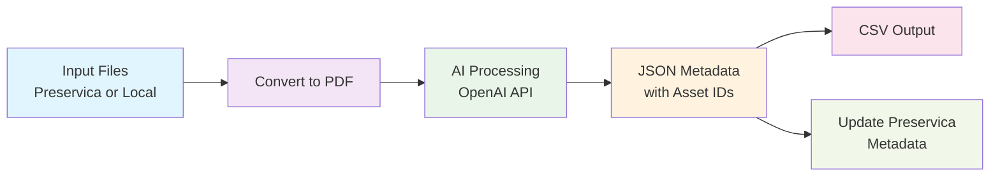
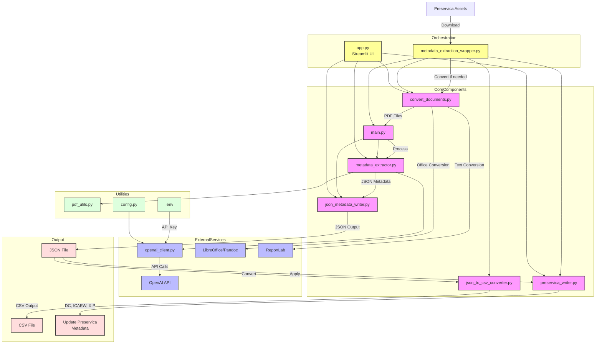

# Metadata Extraction Tool

An AI-powered tool that reads documents and extracts structured metadata — title, creator, date, description, subject tags, and more — using OpenAI's API. Extraction rules are driven by configurable YAML profiles, making the tool adaptable to different organisations and metadata conventions.

**New here?** See [GETTING_STARTED.md](GETTING_STARTED.md) for a step-by-step install and setup guide, including how to create a profile for your own organisation.

## What it does

- Processes PDFs, Word documents, spreadsheets, presentations, images, and text files
- Extracts structured Dublin Core metadata using an AI model
- Applies organisation-specific conventions via configurable YAML profiles
- Outputs results in JSON and CSV formats
- Integrates with Preservica: download assets, extract metadata, and write the results back to the original asset records

## Demo


*Complete workflow: downloading assets from Preservica, AI-powered metadata extraction, and JSON output generation.*

---

## Web UI

A browser-based interface built with [Streamlit](https://streamlit.io):

```bash
streamlit run app.py
```

The app opens automatically in your browser at `http://localhost:8501`.

### Input modes

| Mode | Description |
|------|-------------|
| **Select files** | Upload PDFs, Office documents, or images directly from your computer |
| **Local folder** | Point to a directory on disk; non-PDF files are converted to PDF automatically |
| **Preservica** | Download and process assets from a Preservica repository using folder references or asset IDs, and optionally write the results back |

### Sidebar settings

| Setting | Description |
|---------|-------------|
| **Profile** | Select the metadata extraction profile that defines the organisation-specific conventions and output fields (see [Profiles](#profiles)) |
| **Model** | The OpenAI model used for extraction (default GPT-6.2 Sol); the model used is recorded in each JSON record |
| **Documents at the same time** | How many documents are processed in parallel (1–64, default 32) |
| **Subject classification** | Classify documents against the topic hierarchy defined in the active profile (enabled by default; disable to leave the Subject field empty) |
| **Pages from start / end** | Restrict extraction to the opening and/or closing pages of each document; set both to 0 to process the full document |
| **Context prompt** | Optional background text to help the model identify subjects — for example, the collection, event, or location the documents belong to |
| **JSON / CSV save paths** | Save output files directly to disk; leave blank to use only the download buttons |

### Results and downloads

After extraction, each document's metadata appears in an expandable card showing title, content type, date, creator, publisher, description, subjects, and identifiers. A collapsible **Full JSON** view is available inside each card.

Use the **Download JSON** and **Download CSV** buttons to export results.

For Preservica runs, an **Apply to Preservica** section also appears below the results, so you can review the metadata before writing it back (see [Writing metadata back to Preservica](#writing-metadata-back-to-preservica)).

### Preservica options

When **Preservica** mode is selected, additional options appear:

- **Download by** — choose between **Folder** (all assets under one or more folder UUIDs, one per line) or **Asset IDs** (one or more specific asset UUIDs, one per line)
- **Exclude file extensions** — skip specific file types during download (e.g. `mp4 avi mov`), space-separated
- **Apply metadata to Preservica after extraction** — add the extracted Dublin Core and ICAEW metadata to each asset
- **Update XIP in Preservica after extraction** — set each asset's Preservica title and description from the extracted Title and Description
- **Overwrite existing metadata** — replace existing DC/ICAEW metadata; when unticked, assets that already have it are left unchanged
- **Use asset reference in filenames** — name each downloaded file `<asset UUID>.<ext>`; required for writing metadata back to Preservica
- **Original files only** — download only the first-generation file for each asset

> **Note:** Preservica credentials (`USERNAME`, `PASSWORD`, `TENANT`, `SERVER`) must be set in your `.env` file to enable Preservica downloads and updates.

---

## Profiles

Extraction rules, field vocabulary, and output structure are defined in YAML profile files in the `profiles/` directory. Two profiles are included:

| Profile | File | Description |
|---------|------|-------------|
| **ICAEW** | `profiles/icaew.yaml` | Full ICAEW digital archive conventions — XIP fields, `icaew:ContentType` vocabulary, British English rules, ICAEW topic hierarchy |
| **Default** | `profiles/default.yaml` | Minimal generic Dublin Core profile — a clean starting point for any organisation |

Select the active profile from the sidebar in the UI, or via `--profile` on the command line. To create a profile for your own organisation, copy `profiles/default.yaml`, rename it, and edit the fields. See [GETTING_STARTED.md](GETTING_STARTED.md) for a step-by-step guide.

The AI model is given a system prompt assembled from the active profile, including:
- A role statement describing the archive and its conventions
- Numbered extraction guidelines (generic rules + any profile-specific additions)
- Field-by-field instructions for every output field
- A subject topic list for classification (if the profile provides one)
- Example outputs showing the expected JSON structure and field values

---

## Supported file formats

| Format | Extensions | Processing |
|--------|------------|------------|
| PDF | `.pdf` | Processed directly |
| Office documents | `.docx`, `.doc`, `.xlsx`, `.pptx`, `.ppt` | Converted to PDF |
| Text files | `.txt`, `.srt`, `.vtt` | Converted to PDF |
| Images | `.jpg`, `.jpeg`, `.png`, `.tiff`, `.tif` | Converted to PDF |

---

## Metadata schema

The output fields depend on the active profile. All profiles produce at minimum the standard Dublin Core fields:

- `Title`, `Creator`, `Subject`, `Description`, `Publisher`, `Contributor`
- `Date`, `Type`, `Format`, `Identifier`, `Language`, `Relation`
- `Source`, `Coverage`, `Rights` (reserved — always empty)

The **ICAEW profile** additionally outputs:
- `entity.title`, `entity.description` — mirror fields used by Preservica's XIP schema
- `icaew:ContentType` — controlled vocabulary content type (Annual report, Article, Report, Technical release, etc.)
- `icaew:InternalReference` — reserved for future use
- `icaew:Notes` — entered by staff only; the AI never fills it, and an existing value in Preservica is kept when metadata is overwritten
- `icaew:QA` — set by the code, not the model, to `AI (<model>)`, e.g. `AI (gpt-6.2-sol)`, in the CSV and the Preservica write-back

Reserved fields are always written empty, whatever the model returns. Dates in `Date` use YYYY-MM-DD (or YYYY-MM / YYYY when the document gives less), with numeric dates read in UK day/month order.

---

## Command line

```bash
# Process all files in a folder using the default profile
python main.py --folder ./my-documents -j output.json

# Use a specific profile
python main.py --folder ./my-documents --profile icaew -j output.json

# Limit to the first 5 and last 3 pages of each document
python main.py --folder ./my-documents --first 5 --last 3 -j output.json

# Disable subject classification
python main.py --folder ./my-documents --no-subjects -j output.json

# Use a different OpenAI model (default: gpt-6.2-sol, set in config.py)
python main.py --folder ./my-documents -j output.json --model gpt-6.2-astra

# Change how many documents are processed at the same time (default 32, maximum 64; 1 = one at a time)
python main.py --folder ./my-documents -j output.json --workers 64

# Resume an interrupted run (skip files already recorded in output.json)
python main.py --folder ./my-documents -j output.json --skip-existing

# Convert JSON output to CSV
python json_to_csv_converter.py output.json output.csv
```

For Preservica downloads:

```bash
# Complete workflow — download a folder, extract metadata, output JSON + CSV
python metadata_extraction_wrapper.py --preservica-folder-ref <uuid> --output-dir ./downloads

# Download a single asset
python metadata_extraction_wrapper.py --preservica-asset-ref <uuid> --output-dir ./downloads

# Download a list of assets (one UUID per line in assets.txt)
python metadata_extraction_wrapper.py --preservica-assets-file assets.txt --output-dir ./downloads

# Skip download, process existing files
python metadata_extraction_wrapper.py --skip-download --output-dir ./downloads

# Write results back to Preservica (DC/ICAEW metadata and/or XIP title & description)
python metadata_extraction_wrapper.py --preservica-assets-file assets.txt --apply-metadata --update-xip

# Replace any existing DC/ICAEW metadata
python metadata_extraction_wrapper.py --preservica-folder-ref <uuid> --apply-metadata --overwrite-metadata
```

When writing back from the command line, only the records extracted in the current run are applied, even if the JSON file already contains records from earlier runs.

Run any script with `--help` to see all available options.

---

## Preservica integration

The tool integrates with Preservica to:

- Download assets using folder or asset references
- Maintain Preservica asset IDs (`assetId`) throughout the pipeline — stored in the JSON output and as the first column in the CSV (without the `.pdf` extension)
- Write the extracted metadata back to each asset, from the web UI or the command line

### Writing metadata back to Preservica

There are two independent updates, and you can choose either or both:

| Option | Web UI | CLI | What it writes |
|--------|--------|-----|----------------|
| **Apply metadata** | *Apply metadata to Preservica* | `--apply-metadata` | Dublin Core (`oai_dc`) and ICAEW (`https://www.icaew.com/metadata/`) descriptive metadata |
| **Update XIP** | *Update XIP in Preservica* | `--update-xip` | The asset's Preservica title and description, from the extracted Title and Description |
| **Overwrite** | *Overwrite existing metadata* | `--overwrite-metadata` | With Apply metadata, replace existing DC/ICAEW metadata instead of skipping those assets |

- The asset ID is read from each file's name, so downloads must use **Use asset reference in filenames** (`USE_ASSET_REF = True` in the wrapper).
- Overwrite only affects DC/ICAEW metadata. The XIP title and description are always updated when that option is selected.
- `dc:format` records the format the file was downloaded in (e.g. `docx`), not `pdf` after conversion.
- The XML matches what the standalone `c_add_metadata_from_csv.py` and `d_update_xip_from_csv.py` scripts produce, so the CSV output can still be used with those scripts if you prefer.

---

## Pipeline



<details>
<summary>System architecture diagram</summary>



</details>

---

## Dependencies

- **Python packages**: openai, python-dotenv, PyPDF2, reportlab, Pillow, pyPreservica, pyyaml, streamlit (web UI)
- **External tools**: LibreOffice or Pandoc for document conversion

```bash
pip install -r requirements.txt
```

The web UI's Browse folder picker also requires `tkinter`, which on Ubuntu/Debian must be installed separately:

```bash
sudo apt install python3-tk
```

---

## File structure

Key files:
- `app.py` — Streamlit web UI
- `main.py` — Metadata extraction CLI
- `metadata_extraction_wrapper.py` — Orchestration script (download + convert + extract)
- `convert_documents.py` — Multi-format to PDF conversion
- `metadata_extractor.py` — Core extraction logic
- `openai_client.py` — OpenAI API integration
- `config.py` — Prompt builder; loads profiles and assembles the AI system prompt
- `json_metadata_writer.py` — JSON output handling
- `json_to_csv_converter.py` — JSON to CSV conversion
- `pipeline.py` — Runs local preparation one document at a time and OpenAI calls in parallel
- `media.py` — Links subtitle files to their videos so videos are described from their subtitles
- `download_preservica_assets.py` — Preservica asset download
- `preservica_writer.py` — Writes extracted metadata back to Preservica (DC, ICAEW, XIP)
- `profiles/icaew.yaml` — ICAEW digital archive extraction profile
- `profiles/default.yaml` — Generic Dublin Core profile (starting point for customisation)
- `profiles/topic_list.txt` — ICAEW subject topic hierarchy used by the ICAEW profile

## Notes on behaviour

- The OpenAI model defaults to `gpt-6.2-sol` (`DEFAULT_MODEL` in `config.py`). It can be changed per run with `--model` or in the web UI sidebar, and the model used is recorded in each JSON record.
- `--workers N` (or "Documents at the same time" in the web UI sidebar) processes N documents at the same time (default 32, maximum 64), which is much faster for large batches. Set it to 1 to process one document at a time, which also prints the full metadata for each. Local preparation (checking each PDF and cutting it to the `--first`/`--last` page range) always runs one document at a time; only the OpenAI upload and model calls run in parallel, so CPU-heavy work never piles up. Use this instead of running several terminals: parallel runs in separate terminals writing to the same JSON file can lose records. Cost per document is the same; only the speed changes.
- **Videos with subtitles:** when a Preservica video asset also holds a subtitle file (.srt/.vtt), the subtitles are used as the source, but the record describes the video: Format is the video's format (e.g. `mp4`), Type is `Moving Image`, and the AI is told to describe the video rather than a transcript. The whole transcript is always used (page limits don't apply). The download records the video's format in `media_mapping.json`, so the video file itself can be skipped: `--skip-video-with-subtitles` on `download_preservica_assets.py`, on by default in the wrapper (`--download-videos` to keep videos) and in the web UI. Locally, a subtitle file next to a video with the same name (`talk.srt` + `talk.mp4`) is handled the same way. Writing back to Preservica updates the video asset, because the subtitles belong to it.
- Each document is uploaded to OpenAI for extraction and deleted from OpenAI file storage straight afterwards.
- The model is asked for JSON-only output; if the reply is not valid JSON it is retried once before the file is reported as failed.
- The JSON output file is saved safely after every record, so an interrupted run never leaves it half-written. If an existing output file cannot be read, the tool stops with an error rather than replacing it.
- Typographic characters are normalised (curly quotes become straight quotes). In titles only, dashes used as separators become colons and en dashes in number ranges become hyphens. Other characters such as £ and accented letters are kept.
